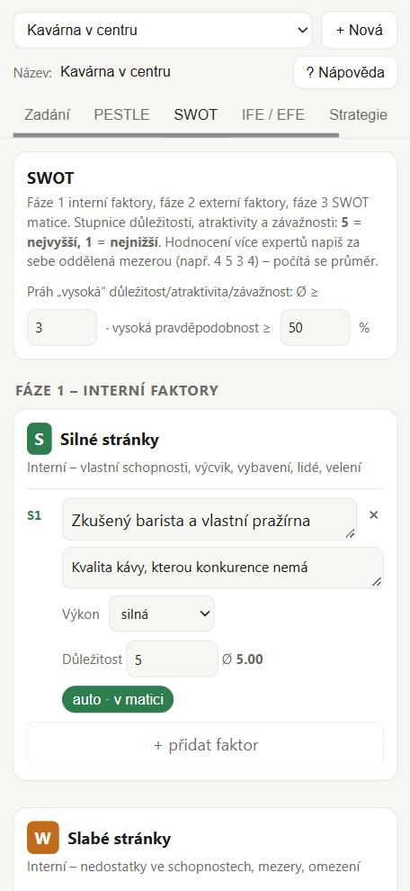

# 📊 SWOT Analýza

Webová appka (PWA) pro **SWOT / TOWS analýzu** — od zadání přes PESTLE, SWOT a IFE/EFE
až po návrh strategií a hotový report. Vše v jednom HTML souboru, bez instalace a bez internetu.

## Náhled

  

## Funkce
- Zadání analýzy — téma, cíl, výchozí situace, potřebné informace
- **PESTLE** analýza vnějšího prostředí
- **SWOT** — silné a slabé stránky, příležitosti a hrozby s hodnocením důležitosti,
  atraktivity a pravděpodobnosti (i průměr z více expertů)
- Matice **IFE / EFE** a návrh strategií (**TOWS**)
- Export reportu do **Wordu (.docx)**, **Markdownu**, **JSON** nebo **Tisk / PDF**
- Více analýz najednou, záloha a obnova přes JSON
- Vše se ukládá v telefonu / prohlížeči, funguje **offline**
- Instalovatelné na plochu jako aplikace (vlastní ikona, běh na celou obrazovku)
- Světlý i tmavý motiv

## Spuštění
Otevři `index.html` v prohlížeči, nebo použij hostovanou verzi přes **GitHub Pages**:

👉 **https://l0cksm1thv.github.io/SWOT_analyza_HTML/**

## Přidání na plochu (jako aplikace)

Appku si můžeš nainstalovat na plochu telefonu — pak se spouští na celou
obrazovku bez lišty prohlížeče, s vlastní ikonou a názvem **SWOT Analýza** a funguje i offline.

### 📱 Android (Chrome)
1. Otevři v prohlížeči **Chrome**: https://l0cksm1thv.github.io/SWOT_analyza_HTML/
2. Klepni na menu **⋮** (tři tečky vpravo nahoře)
3. Vyber **„Přidat na plochu"** (nebo „Nainstalovat aplikaci")
4. Potvrď **„Přidat"**

### 🍏 iPhone / iPad (Safari)
Na iOS to funguje **jen přes Safari** (ne přes Chrome).
1. Otevři v **Safari**: https://l0cksm1thv.github.io/SWOT_analyza_HTML/
2. Klepni na ikonu **Sdílet** (čtvereček se šipkou nahoru, dole uprostřed)
3. Sjeď dolů a vyber **„Přidat na plochu"**
4. Potvrď **„Přidat"** vpravo nahoře

> **Pozn.:** Analýzy se ukládají přímo v zařízení. Na iOS může Safari uložená data
> smazat, pokud appku hodně dlouho vůbec neotevřeš — důležité analýzy si proto
> občas zálohuj přes **Stáhnout .json**.

## Technologie
Čisté HTML, CSS a JavaScript — bez frameworků a bez závislostí.
Ukládání přes `localStorage`, offline přes service worker (`sw.js`).

## Autor
**L0ckSm1thV**
